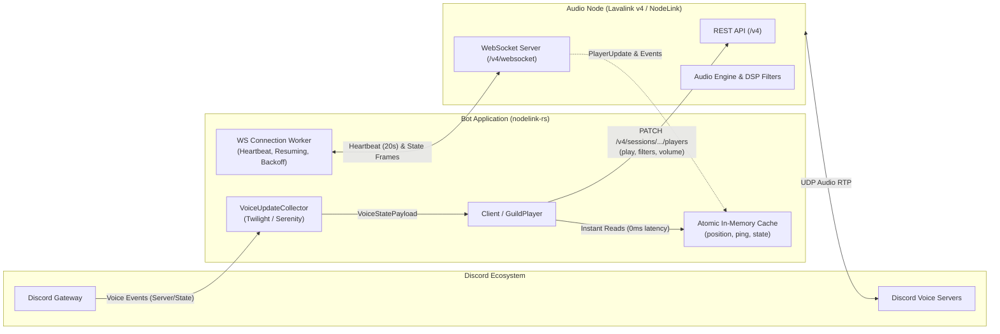

# nodelink-rs

<div align="center">

[](https://crates.io/crates/nodelink-rs)
[](https://docs.rs/nodelink-rs)
[](https://opensource.org/licenses/MIT)
[](https://www.rust-lang.org/)
[](https://lavalink.dev/)
[](https://github.com/PerformanC/NodeLink)

**High-performance, ergonomic asynchronous client for [Lavalink v4](https://lavalink.dev/) and [NodeLink](https://github.com/PerformanC/NodeLink) audio nodes in Rust.**

</div>

---

## Overview

`nodelink-rs` is built for production Discord bots and microservices requiring rock-solid audio playback. It provides complete, strongly-typed DTOs for the Lavalink v4 specification, robust connection lifecycle supervision with automatic session recovery, zero-overhead in-memory player state caching via atomic primitives, and an expressive audio DSP filter pipeline.

### Highlights

* **Full Protocol Compliance:** Strictly typed DTOs for Lavalink v4 / NodeLink REST endpoints and WebSocket events, including plugin metadata and user data payloads.
* **Automatic Session Recovery:** Transparent WebSocket reconnection with exponential backoff and session resumption so active playback is not interrupted during transient network drops.
* **Lock-Free In-Memory State Caching:** Instant reads for `player.position()`, `player.ping()`, `player.state.is_paused()`, and connection status using atomic operations without REST roundtrips.
* **Fluent DSP Filter Pipeline:** Expressive builder API for volume scaling, 15-band equalizers, timescale transformations (speed, pitch, rate), tremolo, vibrato, 8D audio rotation, distortion, channel mixing, low-pass filters, and one-click presets (`nightcore`, `bass_boost`).
* **Multi-Provider Search:** First-class query builders for YouTube (`ytsearch:`), YouTube Music (`ytmsearch:`), SoundCloud (`scsearch:`), Spotify (`spsearch:`), and direct URLs.
* **Framework Agnostic:** Seamless integration with [Twilight](https://twilight.rs), [Serenity](https://github.com/serenity-rs/serenity), [Poise](https://github.com/serenity-rs/poise), or custom microservice backends.

---

## Architecture



---

## Installation

Add `nodelink-rs` and `tokio` to your `Cargo.toml`:

```toml
[dependencies]
nodelink-rs = "0.1"
tokio = { version = "1", features = ["full"] }
```

### Cargo Feature Flags

| Feature | Default | Description |
| :--- | :---: | :--- |
| `rustls-tls` | **Yes** | Uses `rustls` with platform-native roots for secure HTTPS and WSS connections. |
| `native-tls` | No | Uses system-native TLS backend (Schannel on Windows, Secure Transport on macOS, OpenSSL on Linux). |
| `twilight` | No | Enables [`integration::VoiceUpdateCollector`] with `twilight-model` for automatic voice handshake aggregation. |

To use system TLS instead of `rustls`:

```toml
[dependencies]
nodelink-rs = { version = "0.1", default-features = false, features = ["native-tls"] }
```

---

## Quick Start

```rust
use std::time::Duration;
use nodelink_rs::prelude::*;

#[tokio::main]
async fn main() -> Result<(), Box<dyn std::error::Error>> {
    // 1. Configure node credentials and connection details
    let config = Config::new("127.0.0.1:2333", "youshallnotpass", 123456789012345678);
    let (client, mut events) = Client::connect(config).await?;

    // 2. Spawn a background listener for node lifecycle and playback events
    tokio::spawn(async move {
        while let Ok(event) = events.recv().await {
            match event {
                NodeEvent::Ready { session_id, resumed } => {
                    println!("Node ready! Session ID: {session_id} (resumed: {resumed})");
                }
                NodeEvent::PlayerUpdate { guild_id, state } => {
                    println!(
                        "Guild {guild_id}: position={}ms ping={}ms connected={}",
                        state.position, state.ping, state.connected
                    );
                }
                NodeEvent::Stats(stats) => {
                    println!(
                        "Node stats: {}/{} players playing, memory used: {}MB",
                        stats.playing_players, stats.players, stats.memory.used_mb()
                    );
                }
                NodeEvent::Event(event) => {
                    println!("Player event received: {event:?}");
                }
            }
        }
    });

    // 3. Search and load tracks using the ergonomic Query helper
    let result = client
        .load_tracks(Query::youtube("Rick Astley - Never Gonna Give You Up"))
        .await?;

    if let LoadResult::Search(tracks) = result {
        if let Some(track) = tracks.first() {
            println!("Loaded: {} by {}", track.title(), track.author());

            let guild_id = 112233445566778899;
            let player = client.player(guild_id);

            // 4. Play track and adjust volume
            player.play(track).await?;
            player.set_volume(80).await?;

            // 5. Apply audio filters
            player.filters()
                .bass_boost(true)
                .speed(1.05)
                .apply()
                .await?;

            // 6. Read real-time state instantly from memory (zero network overhead)
            println!("Current cached position: {}ms", player.position());
            println!("Current voice latency ping: {}ms", player.ping());
        }
    }

    tokio::time::sleep(Duration::from_secs(5)).await;
    Ok(())
}
```

---

## Player Controls & Cached State

Each guild has its own `GuildPlayer` handle retrieved via `client.player(guild_id)`:

```rust
let player = client.player(guild_id);

// Playback control
player.play(&track).await?;           // Start playing a track
player.set_pause(true).await?;        // Pause playback
player.set_pause(false).await?;       // Resume playback
player.seek(30_000).await?;           // Seek to 30,000ms (30s)
player.set_volume(120).await?;        // Set volume (clamped 0..=1000, 100 default)
player.stop().await?;                 // Stop playback and clear current track
player.destroy().await?;              // Destroy player on the node and free resources

// Zero-overhead in-memory cached state reads (atomic, lock-free, 0ms latency)
let pos_ms = player.position();              // Playback position in milliseconds
let ping_ms = player.ping();                 // Voice round-trip latency to Discord in ms
let connected = player.state.is_connected(); // Connected to Discord voice UDP socket
let is_paused = player.state.is_paused();    // Whether playback is paused
```

---

## Audio Filter Pipeline

`nodelink-rs` provides a fluent, chainable builder for all audio DSP filters supported by Lavalink v4 and NodeLink:

```rust
use nodelink_rs::player::filter::EqBand;

let player = client.player(guild_id);

// 1. One-click presets
player.filters()
    .nightcore(true)
    .apply()
    .await?;

player.filters()
    .bass_boost(true)
    .apply()
    .await?;

// 2. Custom transformations
player.filters()
    .speed(1.15)                         // Playback speed (0.1 to 5.0)
    .pitch(1.20)                         // Pitch multiplier (0.1 to 5.0)
    .rate(1.00)                          // Rate multiplier (0.1 to 5.0)
    .rotation(0.2)                       // 8D Audio / rotation frequency in Hz
    .tremolo(4.0, 0.75)                  // Tremolo (frequency, depth)
    .vibrato(6.0, 0.5)                   // Vibrato (frequency, depth)
    .equalizer(vec![
        EqBand { band: 0, gain: 0.25 },  // 25 Hz
        EqBand { band: 1, gain: 0.15 },  // 40 Hz
        EqBand { band: 2, gain: 0.10 },  // 63 Hz
    ])
    .apply()
    .await?;

// 3. Reset all active filters back to neutral
player.filters().reset().await?;
```

---

## Track Resolution & Query Builders

Construct search terms and URLs using the [`Query`] enum:

```rust
use nodelink_rs::Query;

// Search providers
let q1 = Query::youtube("Never Gonna Give You Up");        // ytsearch:
let q2 = Query::youtube_music("Daft Punk - Get Lucky");    // ytmsearch:
let q3 = Query::soundcloud("Lofi Beats");                  // scsearch:
let q4 = Query::spotify("Taylor Swift");                   // spsearch:

// Direct URLs
let q5 = Query::url("https://www.youtube.com/watch?v=dQw4w9WgXcQ");

// Automatic conversion from &str or String:
// URLs starting with http:// or https:// become Query::Url;
// standard strings default to YouTube search.
let q6: Query = "https://soundcloud.com/user/track".into();
let q7: Query = "Queen - Bohemian Rhapsody".into();

// Resolving tracks
let result = client.load_tracks(q1).await?;
match result {
    LoadResult::Track(track) => println!("Single track: {}", track.title()),
    LoadResult::Playlist { info, tracks, .. } => {
        println!("Playlist '{}' loaded with {} tracks", info.name, tracks.len());
    }
    LoadResult::Search(tracks) => println!("Search returned {} tracks", tracks.len()),
    LoadResult::Empty => println!("No matches found"),
    LoadResult::Error(err) => eprintln!("Load error: {}", err.message),
}
```

---

## Event Handling & Queue Automation

Subscribe to events using `client.subscribe()` or the receiver returned by `Client::connect()`:

```rust
use nodelink_rs::model::events::{NodeEvent, TrackEndReason, TrackEventPayload};

let mut events = client.subscribe();

tokio::spawn(async move {
    while let Ok(event) = events.recv().await {
        match event {
            NodeEvent::Event(TrackEventPayload::TrackStartEvent { guild_id, track }) => {
                println!("Guild {guild_id}: Started playing '{}'", track.title());
            }
            NodeEvent::Event(TrackEventPayload::TrackEndEvent { guild_id, track, reason }) => {
                println!("Guild {guild_id}: Track '{}' ended (reason: {reason:?})", track.title());

                // may_start_next() returns true for Finished and LoadFailed,
                // ideal for advancing auto-play track queues!
                if reason.may_start_next() {
                    // Play the next track in your queue...
                }
            }
            NodeEvent::Event(TrackEventPayload::TrackExceptionEvent { guild_id, track, exception }) => {
                eprintln!("Guild {guild_id}: Error playing '{}': {exception}", track.title());
            }
            NodeEvent::Event(TrackEventPayload::TrackStuckEvent { guild_id, track, threshold_ms }) => {
                eprintln!("Guild {guild_id}: Track '{}' stuck after {threshold_ms}ms", track.title());
            }
            NodeEvent::Event(TrackEventPayload::WebSocketClosedEvent { guild_id, code, reason, by_remote }) => {
                println!("Guild {guild_id}: Voice WS closed (code: {code}, remote: {by_remote}, reason: {reason})");
            }
            _ => {}
        }
    }
});
```

---

## Framework Integrations

### Twilight Integration

Enable the `twilight` feature flag:

```toml
[dependencies]
nodelink-rs = { version = "0.1", features = ["twilight"] }
```

Discord Gateway splits voice handshakes across two separate events: `VoiceStateUpdate` (providing session ID) and `VoiceServerUpdate` (providing token and regional endpoint). The lock-free [`VoiceUpdateCollector`] automatically aggregates them regardless of arrival order:

```rust
use nodelink_rs::integration::VoiceUpdateCollector;
use nodelink_rs::Client;
use std::sync::Arc;
use twilight_gateway::Event;

pub async fn handle_gateway_event(
    event: &Event,
    client: &Arc<Client>,
    collector: &Arc<VoiceUpdateCollector>,
) -> Result<(), Box<dyn std::error::Error>> {
    match event {
        Event::VoiceStateUpdate(state) => {
            if let Some((guild_id, payload)) = collector.process_state(state) {
                client.player(guild_id).provide_voice(payload).await?;
            }
        }
        Event::VoiceServerUpdate(server) => {
            if let Some((guild_id, payload)) = collector.process_server(server) {
                client.player(guild_id).provide_voice(payload).await?;
            }
        }
        _ => {}
    }

    Ok(())
}
```

### Serenity / Poise Integration

For Serenity or Poise bots, forward the gateway payload directly using [`VoiceStatePayload`]:

```rust
use nodelink_rs::model::payload::VoiceStatePayload;
use nodelink_rs::Client;

async fn forward_voice(
    client: &Client,
    guild_id: u64,
    session_id: String,
    token: String,
    endpoint: String,
) -> Result<(), Box<dyn std::error::Error>> {
    let payload = VoiceStatePayload {
        token,
        endpoint,
        session_id,
    };

    client.player(guild_id).provide_voice(payload).await?;
    Ok(())
}
```

---

## Session Resuming & Resilience

`nodelink-rs` is built for high availability:
- **WebSocket Reconnection:** Automatic reconnection with exponential backoff (starting at 500ms, backing off to 15s). If a connection remains stable for 30s, backoff resets back to 500ms.
- **Session Resumption:** Upon handshake, `nodelink-rs` requests a 60-second resume timeout on the node. On reconnect, the previous session token is provided in the WebSocket handshake headers, allowing the node to preserve active player streams without audio stutter.
- **Heartbeats:** Periodic 20-second WebSocket ping frames ensure half-open TCP connections are promptly detected and reconnected.

---

## License

This project is licensed under the [MIT License](LICENSE).
